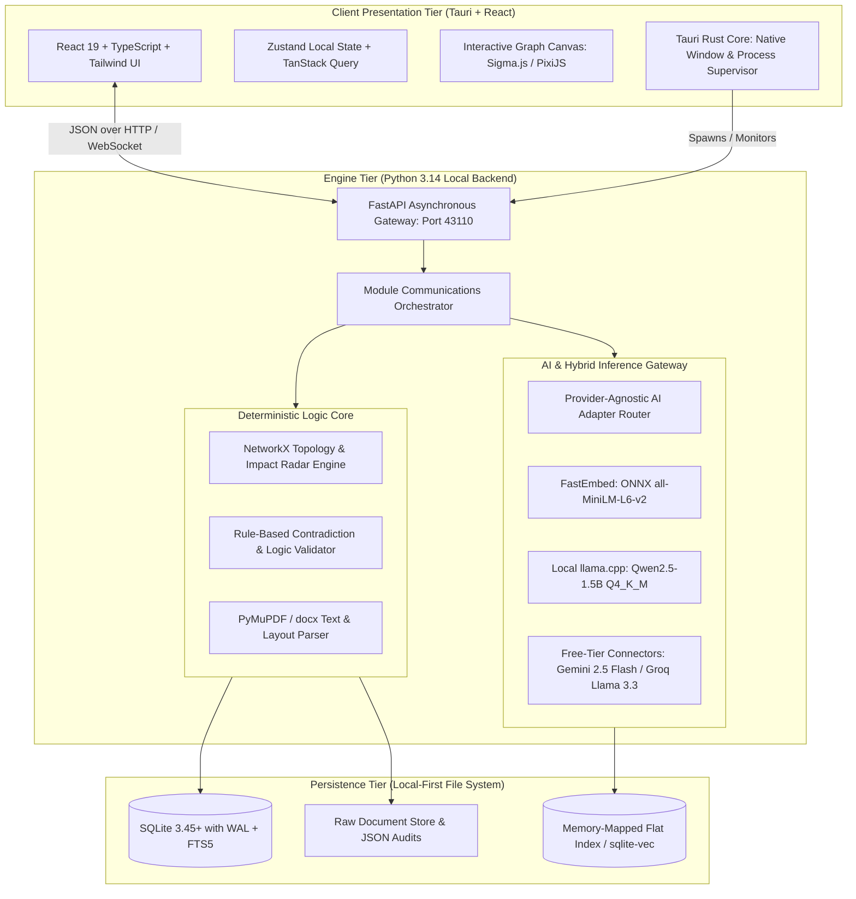
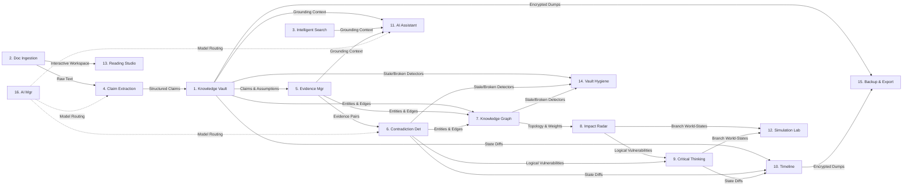

# MindVault — System Architecture Document (SAD)
**Document Version:** 1.0.0  
**Status:** Approved Architectural Baseline  
**Target Platform:** Windows 10/11 (64-bit), Optimized for 8 GB RAM / Dual-Core Hardware  
**License:** Apache License 2.0  

---

## 1. Executive Summary & Vision

**MindVault** is an independently installable, local-first Personal Knowledge Intelligence System (*"Your Personal Knowledge Debugger"*). Unlike traditional note-taking applications (Obsidian, Notion) or conversational AI wrappers, MindVault treats knowledge as a verifiable, interconnected, and evolving mathematical graph.

The system is engineered to answer fundamental epistemological questions:
- *What do I know, and why do I believe it?*
- *What empirical evidence supports or contradicts this claim?*
- *If assumption $A$ is invalidated, what conclusions collapse?*
- *How has my understanding of concept $X$ evolved over time?*

To guarantee rock-solid stability on an 8 GB RAM / Intel Core i3 environment, MindVault implements a **Hybrid Deterministic Architecture**:
1. All critical graph analysis, impact propagation, full-text search, and contradiction candidate matching are executed using **deterministic code, relational constraints, and graph algorithms**.
2. AI (Local SLMs + Free-tier Cloud APIs + Kaggle GPU acceleration) is reserved strictly for non-deterministic tasks: linguistic claim extraction, semantic nuance evaluation, and narrative synthesis.

---

## 2. Hardware Budget & Deployment Profile

| Physical Resource | Measured Baseline | MindVault Budget Limit | Allocation Strategy |
| :--- | :--- | :--- | :--- |
| **CPU** | Intel Core i3-1005G1 (2C/4T @ 1.20GHz) | $\le 40\%$ sustained background | Asynchronous background workers via Python `asyncio` & `ProcessPool` with single-worker limits. |
| **RAM** | 7.77 GB (~2.1 GB free) | $\le 1.4$ GB Total App Footprint | • Tauri Frontend: ~40 MB<br>• Python FastAPI Core: ~120 MB<br>• SQLite + FTS5: ~30 MB<br>• Local ONNX Embeddings: ~90 MB<br>• Local SLM (Optional): $\le 1.1$ GB |
| **GPU** | Intel UHD Graphics (Shared VRAM) | Zero VRAM assumption | All local models compiled for CPU/AVX2 via ONNX Runtime / `llama.cpp`. |
| **Storage** | 128 GB SSD Free (`C:\`) | $\le 2$ GB for app & dependencies | SQLite in WAL mode; compressed vector stores. |
| **Network** | Variable / Offline | Graceful degradation | Core vault, graph, search, and impact radar are **100% functional offline**. Cloud APIs augment when connected. |

---

## 3. High-Level System Architecture

MindVault adopts a decoupled, multi-tier desktop architecture:



---

## 4. The 16 Core Functional Modules & Inter-Module Communication

MindVault connects 16 specialized modules across a unified **Knowledge Bus**:



### Module Responsibilities:
1. **Knowledge Vault:** Central entity repository managing Notes, Claims, Assumptions, and Concepts.
2. **Document Ingestion:** Parses PDFs, DOCX, and TXT using PyMuPDF; extracts layout, heading hierarchy, and persistent source coordinates (`page`, `bounding_box`).
3. **Intelligent Search:** Hybrid Search combining SQLite FTS5 (BM25 keyword matching) and dense vector cosine similarity via Reciprocal Rank Fusion (RRF).
4. **Claim Extraction:** Deconstructs unstructured prose into atomic propositions: `Subject`, `Predicate`, `Object`, `Modality` (e.g., *Definite*, *Probable*, *Hypothetical*).
5. **Evidence Management:** Connects claims to supporting or opposing citations; grades source reliability ($A$ to $F$), independence, and verification status.
6. **Contradiction Detection:** Two-stage pipeline: (1) High-recall semantic opposite candidate filtering; (2) Natural Language Inference (NLI) premise-hypothesis verification.
7. **Knowledge Graph:** Directed attributed multigraph maintained in NetworkX; renders interactive topologies with force-directed layouts.
8. **Knowledge Impact Radar:** Calculates graph centrality (PageRank, Betweenness) to discover foundational assumptions; performs reverse-dependency cascades when a premise weakens.
9. **Critical Thinking Engine:** Algorithmic fallacy scanner (circular reasoning, ungrounded leap, correlation vs causation) coupled with LLM socratic evaluation.
10. **Knowledge Timeline:** Append-only cryptographic ledger of all edits, verification flips, and belief revisions over time.
11. **AI Research Assistant:** Strictly grounded RAG assistant; enforces traceable citations (`[Source: Doc#4, p.12]`) and explicit refusal if evidence is absent.
12. **Simulation Lab:** "What-If" branch sandboxing. Clones the knowledge graph into an in-memory ephemeral layer, toggles an assumption's truth-value, and evaluates the cascading impact.
13. **Reading & Research Workspace:** Split-pane reader enabling instant highlight-to-claim conversions while maintaining visual bounding-box anchors.
14. **Knowledge Maintenance:** Vacuum and linting engine: discovers orphaned claims, circular evidence rings, dead references, and stale assertions.
15. **Backup & Restore:** Zero-loss SQLite snapshot streaming, automated daily backups, and open-format exports (Markdown + JSON-LD).
16. **AI Model & Provider Manager:** Real-time switcher between Local ONNX, local GGUF SLM, Google Gemini free API, Groq Cloud API, or offline fallback.

---

## 5. Unified Relational Knowledge Schema (SQLite DDL)

MindVault enforces referential integrity through foreign keys and WAL mode.

```sql
PRAGMA foreign_keys = ON;
PRAGMA journal_mode = WAL;

-- 1. Source Documents & Ingestion
CREATE TABLE documents (
    id TEXT PRIMARY KEY, -- UUIDv7 (time-sortable)
    title TEXT NOT NULL,
    file_path TEXT NOT NULL,
    file_hash_sha256 TEXT NOT NULL UNIQUE,
    mime_type TEXT NOT NULL,
    page_count INTEGER DEFAULT 1,
    metadata_json TEXT, -- Authors, publication date, DOI
    created_at TIMESTAMP DEFAULT CURRENT_TIMESTAMP,
    updated_at TIMESTAMP DEFAULT CURRENT_TIMESTAMP
);

-- 2. Core Knowledge Units (Notes, Concepts)
CREATE TABLE knowledge_nodes (
    id TEXT PRIMARY KEY,
    node_type TEXT CHECK(node_type IN ('NOTE', 'CONCEPT', 'CLAIM', 'ASSUMPTION', 'HYPOTHESIS', 'QUESTION', 'CONCLUSION')) NOT NULL,
    title TEXT NOT NULL,
    content TEXT NOT NULL,
    status TEXT CHECK(status IN ('DRAFT', 'ACTIVE', 'VERIFIED', 'CHALLENGED', 'DEPRECATED')) DEFAULT 'ACTIVE',
    confidence_score REAL DEFAULT 1.0 CHECK(confidence_score BETWEEN 0.0 AND 1.0),
    created_at TIMESTAMP DEFAULT CURRENT_TIMESTAMP,
    updated_at TIMESTAMP DEFAULT CURRENT_TIMESTAMP
);

-- 3. Atomic Claims (Deconstructed Propositions)
CREATE TABLE claims (
    id TEXT PRIMARY KEY,
    node_id TEXT NOT NULL REFERENCES knowledge_nodes(id) ON DELETE CASCADE,
    subject TEXT NOT NULL,
    predicate TEXT NOT NULL,
    object TEXT NOT NULL,
    modality TEXT CHECK(modality IN ('CERTAIN', 'PROBABLE', 'POSSIBLE', 'SPECULATIVE')) DEFAULT 'CERTAIN',
    source_doc_id TEXT REFERENCES documents(id) ON DELETE SET NULL,
    source_location_json TEXT, -- {page: 3, snippet: "...", bounding_box: [...]}
    created_at TIMESTAMP DEFAULT CURRENT_TIMESTAMP
);

-- 4. Evidence Items (Supporting or Refuting)
CREATE TABLE evidence (
    id TEXT PRIMARY KEY,
    claim_id TEXT NOT NULL REFERENCES claims(id) ON DELETE CASCADE,
    source_doc_id TEXT REFERENCES documents(id) ON DELETE RESTRICT,
    polarity TEXT CHECK(polarity IN ('SUPPORTS', 'REFUTES', 'QUALIFIES')) NOT NULL,
    excerpt TEXT NOT NULL,
    reliability_tier TEXT CHECK(reliability_tier IN ('PEER_REVIEWED', 'OFFICIAL_REPORT', 'EXPERT_OPINION', 'UNVERIFIED', 'ANECDOTAL')) DEFAULT 'UNVERIFIED',
    notes TEXT,
    created_at TIMESTAMP DEFAULT CURRENT_TIMESTAMP
);

-- 5. Contradiction Registry
CREATE TABLE contradictions (
    id TEXT PRIMARY KEY,
    claim_a_id TEXT NOT NULL REFERENCES claims(id) ON DELETE CASCADE,
    claim_b_id TEXT NOT NULL REFERENCES claims(id) ON DELETE CASCADE,
    severity TEXT CHECK(severity IN ('DIRECT_MUTUAL_EXCLUSION', 'NUMERICAL_DISCREPANCY', 'CONTEXTUAL_TENSION', 'TEMPORAL_EVOLUTION')) NOT NULL,
    explanation TEXT NOT NULL,
    resolution_status TEXT CHECK(resolution_status IN ('OPEN', 'EXPLAINED_CONTEXT', 'SUPERSEDED', 'RESOLVED')) DEFAULT 'OPEN',
    detected_at TIMESTAMP DEFAULT CURRENT_TIMESTAMP,
    resolved_at TIMESTAMP
);

-- 6. Knowledge Graph Edges (Ontological & Causal)
CREATE TABLE graph_edges (
    id TEXT PRIMARY KEY,
    source_node_id TEXT NOT NULL REFERENCES knowledge_nodes(id) ON DELETE CASCADE,
    target_node_id TEXT NOT NULL REFERENCES knowledge_nodes(id) ON DELETE CASCADE,
    relation_type TEXT NOT NULL, -- e.g. 'DEPENDS_ON', 'DERIVED_FROM', 'CONTRADICTS', 'CAUSES', 'EXPLAINS'
    weight REAL DEFAULT 1.0,
    metadata_json TEXT,
    created_at TIMESTAMP DEFAULT CURRENT_TIMESTAMP
);

-- 7. Audit & Belief Evolution Timeline
CREATE TABLE timeline_events (
    id TEXT PRIMARY KEY,
    entity_id TEXT NOT NULL,
    event_type TEXT NOT NULL, -- e.g. 'CLAIM_CREATED', 'EVIDENCE_ADDED', 'STATUS_CHANGED', 'CONFIDENCE_ADJUSTED'
    previous_state_json TEXT,
    new_state_json TEXT,
    reason TEXT,
    created_at TIMESTAMP DEFAULT CURRENT_TIMESTAMP
);

-- 8. Full-Text Search Virtual Table (FTS5)
CREATE VIRTUAL TABLE knowledge_fts USING fts5(
    title,
    content,
    content='knowledge_nodes',
    content_rowid='rowid'
);
```

---

## 6. AI & Free Cloud Computing Strategy

```
               ┌──────────────────────────────────────────────────────────┐
               │                MindVault AI Request Router               │
               └────────────────────────────┬─────────────────────────────┘
                                            │
                     ┌──────────────────────┴──────────────────────┐
                     ▼                                             ▼
       [Local Low-Compute Path]                      [Complex Reasoning / Research]
       • Task: Embeddings & Vector Search            • Task: Deep Claim Extraction, NLI
       • Engine: FastEmbed (ONNX Runtime)            • Engine: Cloud API Adapters (Free Tier)
       • Model: all-MiniLM-L6-v2 (QInt8)             • Provider 1: Google Gemini 2.5 Flash
       • Footprint: ~90 MB RAM, 0% GPU               • Provider 2: Groq Llama 3.3 70B
       • Offline: 100% Fully Functional              • Cost: $0.00 / Zero RAM load
                                                                   │
                                                                   │ (If offline & user requests local)
                                                                   ▼
                                                     [Local Fallback SLM]
                                                     • Engine: llama-cpp-python (AVX2)
                                                     • Model: Qwen 2.5 1.5B Q4_K_M
                                                     • Footprint: ~1.1 GB RAM
```

### Cloud GPU Strategy (Kaggle & Colab)
* **Usage Domain:** Offline batch document indexing, synthetic dataset generation, and academic benchmark evaluations.
* **Protocol:** A companion repository directory `/research/benchmarks` will contain headless Jupyter Notebooks configured to run on Kaggle's dual Tesla T4 GPUs (30 hours/week free). The notebooks produce benchmark logs and pre-indexed SQLite dumps that can be dropped directly into the desktop client.

---

## 7. Phased Implementation Roadmap

| Phase | Milestone Name | Key Deliverables | Verification Criterion |
| :---: | :--- | :--- | :--- |
| **01** | **Foundation & SAD** | Approved SAD, Git repository, Apache 2.0 license, clean Python venv, Tauri+React scaffold. | Automated sanity check compiles; empty window launches with $\le 60$ MB RAM. |
| **02** | **Database & Knowledge Vault** | SQLite engine, Alembic migrations, CRUD for Notes/Concepts/Claims, FTS5 integration. | 10,000 synthetic notes inserted and searched via FTS5 in $< 50$ ms. |
| **03** | **Ingestion & Reading Studio** | PyMuPDF text & bounding-box extractor, document viewer, manual claim formulation UI. | PDF uploaded, text highlighted, and converted into an anchored claim with persistent coordinates. |
| **04** | **Hybrid Search & Evidence Engine** | FastEmbed ONNX pipeline, vector similarity, Reciprocal Rank Fusion, Evidence linker. | Hybrid query returns relevant claim with exact supporting source citation. |
| **05** | **Contradiction & Logic Engine** | Rule-based pair filtering + NLI contradiction classifier, conflict explanation UI. | Benchmark dataset of 50 opposing claim pairs achieves $\ge 85\%$ detection precision. |
| **06** | **Knowledge Graph & Impact Radar** | NetworkX graph integration, Sigma.js/PixiJS interactive canvas, dependency impact cascades. | Modifying a root assumption calculates all affected downstream conclusions instantly. |
| **07** | **Critical Thinking & Simulation** | Fallacy heuristic scanner, "What-If" branch sandboxing, timeline version audit. | User branches a scenario, modifies two variables, and compares original vs simulated state. |
| **08** | **AI Assistant & Packaging** | Multi-provider RAG engine, MSI/NSIS Windows installer, end-to-end regression tests. | Clean install on fresh Windows machine without Python/Node prerequisites. |

---

## 8. Research & Publication Blueprint

To establish MindVault as a peer-reviewed research contribution:
1. **Target Venues:** ACM SIGIR (Search & Information Retrieval), EMNLP/ACL (Information Extraction & NLI), or JCDL (Digital Libraries).
2. **Novel Research Claims:**
   * *Epistemic Dependency Modeling:* A formal graph-theoretic formulation for quantifying conclusion vulnerability based on premise confidence decays.
   * *Context-Aware Contradiction Disambiguation:* Distinguishing genuine factual contradictions from temporal drift and domain differences.
3. **Artifact Directory:** `/research` containing reproducible benchmark scripts, evaluation datasets, and experimental metrics comparing MindVault against standard Obsidian/RAG baselines.
